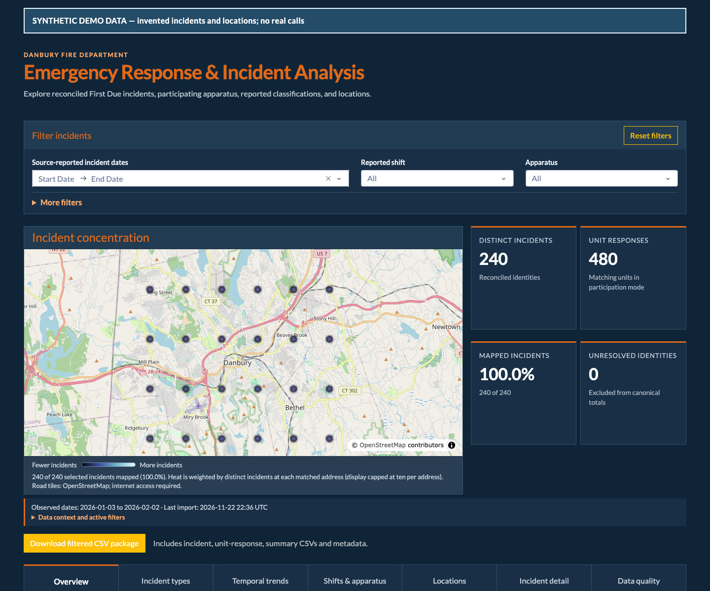

# Emergency Response dashboard

A Dash portfolio project for exploring incident patterns. The public demo uses **240 invented incidents and 24 fictional locations**. No operational call records or address cache are tracked.



## Run the demo

Use Python 3.11–3.14. From the repository root:

```sh
python3 -m venv .venv
.venv/bin/python -m pip install -c constraints.txt -e '.[dev]'
.venv/bin/dfd-dashboard demo
```

Open <http://127.0.0.1:8050/>. The first run builds an ignored, synthetic SQLite database. Stop the server with Ctrl-C. The [demo data notes](demo/README.md) explain how the invented CSV and coordinates are made.

## Explore

- Filter by date, shift, apparatus, classification, and location across seven views.
- Compare distinct incidents with incident–apparatus participations; the dashboard keeps those counts separate.
- Inspect data quality, a weighted location heatmap, and filtered CSV exports.

The dashboard does not calculate response times or target attainment because its source format lacks the required timing fields. See [metrics](docs/metrics.md) for counting rules and [limitations](docs/known_limitations.md) for the remaining boundaries.

## Design and privacy

The [architecture](docs/architecture.md) describes CSV validation, SQLite reconciliation, shared filters, and Dash callbacks. The [data dictionary](docs/data_dictionary.md) lists supported fields. The `demo` command uses only its marked synthetic database; the separate `serve` command is restricted to localhost for authorized local work. A public deployment must use the demo database, including when a proxy or tunnel is involved.

OpenStreetMap supplies road tiles and Bootstrap supplies a stylesheet. Neither request contains incident rows or address text. Dash serves incident data to the viewing browser, so operational data must never be used for the public demo.

## Verify

```sh
.venv/bin/python -m pytest -q
.venv/bin/python -m ruff check .
.venv/bin/python -m ruff format --check .
```

The latest [validation record](docs/validation.md) reports 18 passing tests and a browser render of the synthetic map. Existing Ruff cleanup remains open.
